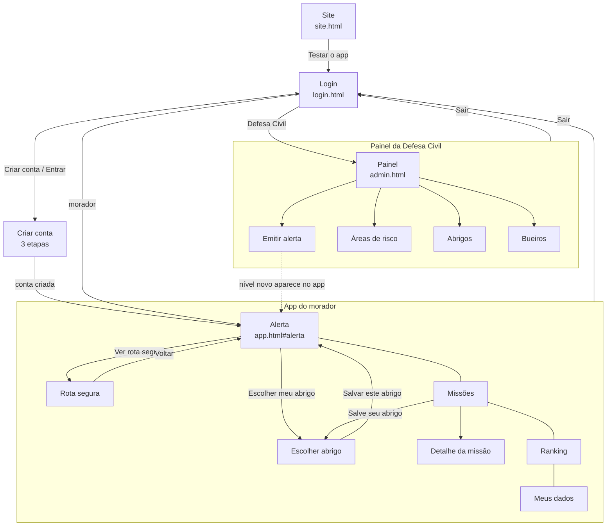

# ALERA · Sprint 2 de Frontend Design: fluxos e arquitetura

Este documento descreve os três fluxos principais do protótipo, os componentes de cada página (com os nomes do design system "Noite de Chuva") e o fluxograma de navegação. Os componentes com os seis estados ficam na vitrine [`frontend/app/componentes.html`](../../frontend/app/componentes.html).

> **Para testar sem servidor:** no protótipo publicado, a tela de login mostra o **Modo demonstração**. "Entrar como morador" abre o app e "Entrar como admin" abre o painel da Defesa Civil, os dois com dados de exemplo.

## Os três fluxos

| # | Fluxo | Perfil | Páginas |
| --- | --- | --- | --- |
| 1 | **Garantir o abrigo e a rota segura** (fluxo principal) | Morador cadastrado | `app.html#alerta` → `#detalhe-abrigo` → `#alerta` → `#rota` |
| 2 | Criar conta | Morador novo | `site.html` → `login.html#cadastro` (3 etapas) → `app.html#alerta` |
| 3 | Emitir alerta para uma área | Agente da Defesa Civil | `login.html` → `admin.html#painel` → `#alertas` → confirmação |

---

### Fluxo 1 (principal): garantir o abrigo e a rota segura

**Perfil do usuário.** Morador de uma área de risco de Juiz de Fora, já cadastrado. Usa o celular, muitas vezes com pressa e com a chuva começando. Não é especialista em tecnologia e precisa entender o risco em poucos segundos.

**Tarefa.** Ver o nível de risco da própria rua, escolher o abrigo para onde vai e abrir o caminho até ele.

**Caminho principal.**

1. Abre o app na tela **Alerta**. Vê o nível (Normal, Atenção, Alerta ou Perigo), o que fazer e o abrigo aberto mais perto.
2. Toca em **Escolher meu abrigo**. Abre a janela com o mapa e a lista de abrigos, do mais perto ao mais longe.
3. Usa a seleção **Mostrar** para ver "Só os que recebem gente agora".
4. Toca em **Ver no mapa** num card: o pino é destacado e o card fica ativo.
5. Toca em **Salvar este abrigo**. A missão "Salve seu abrigo" é concluída (+10 pontos) e o abrigo passa a aparecer no Alerta.
6. Volta ao Alerta e toca em **Ver rota segura**. A tela **Rota segura** mostra o caminho e as ruas a evitar.

**Caminhos alternativos.**

- **Endereço errado:** em **Meus dados**, digita o CEP. O campo busca a rua, o bairro e a cidade sozinho (ViaCEP). Ao salvar, o nível e as distâncias são recalculados.
- **Nível Perigo:** a frase do Alerta manda sair de casa e o botão **Ligar 199** fica em destaque.
- **Abrigo salvo está fechado:** o Alerta avisa e indica o abrigo aberto mais perto.
- **Atalho pelas Missões:** a missão "Salve seu abrigo mais perto" abre a mesma janela.

**Pontos de falha e o que o app faz.**

| Falha | O que a pessoa vê |
| --- | --- |
| Sem internet ou API fora do ar | Aviso de que não deu para atualizar, com **Tentar de novo**. O app não mostra "Normal" no lugar do dado que falta. O botão Ligar 199 é um link `tel:` e funciona sem internet |
| Abrigos não carregaram | A seleção **Mostrar** fica com erro e pede "Atualizar lista" |
| Não salvou o abrigo | O botão vira **Tentar de novo** (vermelho) e o card mostra o motivo |
| CEP não existe | O campo de CEP fica com erro: "Não achamos este CEP" |
| Casa sem ponto no mapa | A lista avisa que sem o ponto não dá para calcular a distância e leva a Meus dados |
| Filtro sem resultado | "Nenhum abrigo com esse filtro agora" |
| Sessão expirada | O app renova a sessão sozinho; se ela acabou de verdade, volta para o login. Uma queda de rede não derruba a sessão |

---

### Fluxo 2: criar conta

**Perfil do usuário.** Morador que conheceu o ALERA pelo site ou por um vizinho e ainda não tem conta.

**Tarefa.** Criar a conta com e-mail, senha, telefone com WhatsApp e endereço, e entrar no app.

**Caminho principal.**

1. No site, toca em **Testar o app** e chega ao **Login**.
2. Toca em **Criar conta**. O cadastro tem 3 etapas, com o indicador de etapas no topo.
3. **Conta:** e-mail, senha (com medidor de força) e telefone.
4. **Endereço:** digita o CEP e a rua, o bairro e a cidade chegam sozinhos. Completa o número.
5. **Confirmar:** revisa os dados (com atalhos para corrigir cada etapa), marca a caixa de consentimento (LGPD) e cria a conta. O app abre na tela Alerta da rua dele.

**Caminhos alternativos.**

- **Casa sem número:** marca "Minha casa não tem número" e o campo de número é desativado.
- **Já tem conta:** o link **Entrar** volta para o login.
- **Voltar uma etapa:** os dados digitados continuam lá.

**Pontos de falha.**

| Falha | O que a pessoa vê |
| --- | --- |
| Campo vazio ou inválido | Erro embaixo do campo, e o foco vai para ele |
| E-mail já cadastrado ou dado recusado pelo servidor | O cadastro volta para a etapa do campo errado e mostra a mensagem embaixo dele |
| Muitas tentativas seguidas | Mensagem pedindo para esperar antes de tentar de novo |
| Senha fraca | O medidor fica vermelho e a dica pede no mínimo 8 caracteres |
| CEP não encontrado | Aviso para preencher a rua à mão |
| Consentimento não marcado | "Marque a caixa para concordar e criar sua conta." |
| Servidor fora do ar | Mensagem de erro geral, e o botão volta a ficar ativo |

---

### Fluxo 3: emitir alerta (Defesa Civil)

**Perfil do usuário.** Agente da Defesa Civil de Juiz de Fora, no computador da central, acompanhando a chuva.

**Tarefa.** Mudar o nível de uma ou mais áreas de risco e mandar a orientação aos moradores.

**Caminho principal.**

1. Entra pelo **Login** com a conta de administrador e cai no **Painel**, com a situação de cada área.
2. Abre **Emitir alerta**.
3. Escolhe as áreas no mapa ou na lista, o nível e escreve a orientação (até 160 caracteres).
4. Confere a prévia **Como o morador vê**.
5. Confirma. O alerta entra em **Últimos alertas** e aparece no app de quem mora nas áreas escolhidas.

**Caminhos alternativos.** Cadastrar ou editar uma **área de risco** e um **abrigo** (aberto, poucas vagas, só em alerta, fechado), e ver os **bueiros** (prévia da Fase 2).

6. Pelo botão **Ver app**, confere a tela do morador. No modo demonstração, um alerta emitido para a **Encosta do Centro** muda o nível da Rua Halfeld, a rua do morador de exemplo.

**Pontos de falha.**

| Falha | O que o agente vê |
| --- | --- |
| Nenhuma área escolhida | "Escolha pelo menos uma área no mapa ou na lista." |
| Orientação vazia | O formulário não envia e pede o texto |
| Mesmo nível e mesma orientação | "Nada mudou: essas áreas já estavam com esse nível" |
| Sem conexão com o servidor | "Sem conexão com o servidor. O alerta não foi emitido." |
| Conta de morador tentando abrir o painel | É mandada para o app do morador |

Antes do envio, uma janela de confirmação repete o nível e as áreas, para evitar alerta por engano.

---

## Componentes por página

Nomes de acordo com o design system "Noite de Chuva" (`css/tokens.css`, `css/app.css`).

| Página | Componentes |
| --- | --- |
| **Site** (`site.html`) | Topo com menu, botão de tema, seções com cards de nível (Normal, Atenção, Alerta, Perigo), cards de missão, cards dos gadgets, botão "Testar o app", rodapé com referências |
| **Login** (`login.html`) | Cartão central, marca, botão de tema, campo de texto (e-mail), campo de senha com botão mostrar, caixinha "Continuar conectado", botão principal, bloco do modo demonstração |
| **Criar conta** (`login.html#cadastro`) | Indicador de etapas, campos de texto, campo de senha com medidor de força, campo de CEP com busca, caixinha "sem número", botões Voltar e Continuar |
| **Alerta** (`app.html#alerta`) | Topo com Ligar 199, menu (lateral no computador, abas embaixo no celular), cartão de nível com selo e medidor, mapa, painel do abrigo, botões "Ver rota segura" e "Escolher meu abrigo", botão Ligar 199, cards "O que fazer em cada nível" |
| **Escolher abrigo** (`#detalhe-abrigo`) | Janela (dialog), mapa com pinos, **seleção** "Mostrar", **cards de abrigo** com **botões**, botão de texto "Atualizar lista" |
| **Rota segura** (`#rota`) | Botão voltar, mapa, aviso de ruas a evitar, painel do abrigo de destino |
| **Missões** (`#missoes`) | Placar de pontos com barra, abas Para fazer / Concluídas, cards de missão com progresso, janelas de detalhe |
| **Ranking** (`#ranking`) | Painel "Posição da sua rua", lista do ranking |
| **Meus dados** (`#cadastro`) | **Campos de texto**, **campo de CEP com busca (composto)**, caixinha "sem número", **botão** Salvar, mapa da casa |
| **Painel da Defesa Civil** (`admin.html`) | Menu lateral, cards de situação das áreas, mapa de áreas, lista de áreas com caixinhas, opções de nível (rádio), área de texto da orientação, prévia do alerta, formulários de área e abrigo com seleção |
| **Componentes** (`componentes.html`) | Vitrine dos 5 componentes do fluxo principal em 6 estados |

## Fluxograma de navegação

As quatro abas do app (Alerta, Missões, Ranking, Meus dados) ficam sempre no menu: a pessoa vai de qualquer uma para qualquer outra. O botão **Ligar 199** aparece no topo de todas as telas do app.

## Critérios técnicos atendidos

- **HTML semântico:** `header`, `nav` com `aria-label`, `main`, `section` com `aria-labelledby`, `footer`, `form`, `fieldset`/`legend`, `dialog` (role) nas janelas.
- **Hierarquia de títulos:** um `h1` por tela, `h2` nos blocos e `h3`/`h4` dentro deles.
- **Celular primeiro:** no celular o menu vira abas embaixo; no computador, menu lateral. Telas conferidas em 390 px e 1366 px.
- **Teclado:** tudo funciona com `Tab`, `Enter` e espaço; foco visível em tudo (`:focus-visible` no `base.css`); nenhum `outline: none` sem substituto. No cadastro, o foco vai para o título de cada etapa e para o primeiro campo com erro.
- **Acessibilidade conferida com axe-core:** nenhuma violação WCAG 2 A/AA nas telas do app, login, painel e vitrine.
- **Contraste:** cores conferidas pela WCAG 2.1 (anotadas no `tokens.css`), nos temas claro e escuro.
